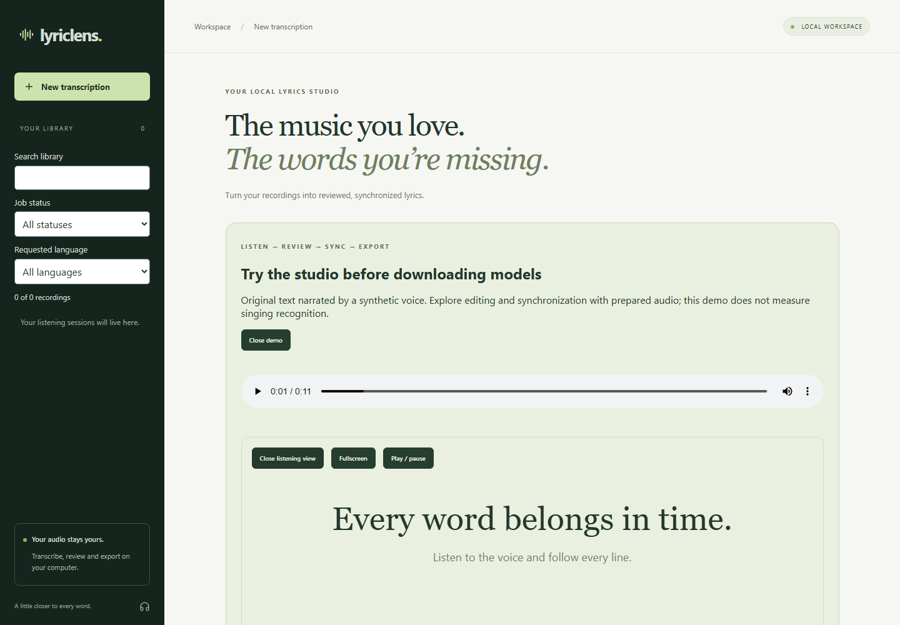

# LyricLens

Your local studio for reviewed, synchronized lyrics. Upload a recording, listen closely, refine the words, synchronize passages, and export the result.

**Try it before downloading models:** open **Open interactive demo** on the upload page. Edit original English text, follow the prepared synthetic voice, mark line starts and export LRC. The bundled demo works without the backend or recognition models; it demonstrates the editor, not singing accuracy.



[Watch the short studio walkthrough](lyriclens-app/docs/images/studio-demo.webm) · [Listening and synchronization guide](lyriclens-app/docs/LISTENING_STUDIO.md)


## Features

- **Seven language choices:** Korean, Japanese, Mandarin Chinese, English, Spanish, Portuguese and French, plus automatic whole-clip detection.
- **Local recognition:** Whisper Small, experimental Small with native alignment, or experimental Large-v3, with optional Demucs vocal separation and side-by-side results. Model and isolation controls are under **Advanced transcription options**.
- **Review and export:** waveform seeking, undo/redo, keyboard shortcuts, segment repeat, playback speed, Unicode editing, passage retranscription, a navigable review-suggestion list, and TXT, JSON, SRT or LRC export.
- **Listening studio:** sticky original player, current-passage highlighting, fullscreen lyric following, optional saved translation, and tap-to-synchronize line starts using the current editor text.
- **Optional local translation:** choose a target language, review translated segments beside the saved source, and export the translation separately.
- **Persistent history:** saved titles, search, status/language filters, cancellation and deletion, with audio stored locally. Send up to 20 recordings to the existing local queue from the batch uploader.
- **Bring your lyrics:** import TXT or LRC, preview changes, preserve existing passage times or start manual synchronization from evenly distributed lines.
- **Suggested lyric timing:** match imported lines to the existing recognized text in order and estimate positions within passages. Review by listening; this is text-based timing assistance, not acoustic forced alignment.
- **Workspace tools:** resume unfinished tasks, inspect stage progress, check local setup and clear generated cache selectively. See [recovery and review tools](lyriclens-app/docs/RELIABILITY.md).
- **Editing and backup:** recover browser drafts, search lyrics, split/merge segments, export bilingual TXT/SRT and restore per-job backups. See the [editing guide](lyriclens-app/docs/EDITING.md).
- **Multilingual review:** assign languages to saved passages, retranscribe them and compare differences between recognition routes. See the [multilingual guide](lyriclens-app/docs/MULTILINGUAL.md).

**Formats:** WAV, MP3, FLAC, M4A and MP4. Default limits: **10 minutes of audio** and **150 MiB per upload**. MP4 processing uses the first audio track and ignores video frames.

## Quick start

On Windows, open a terminal in the repository folder and run:

```powershell
.\setup.cmd -InstallPrerequisites
.\start.cmd
```

Setup prepares Python 3.11, Node.js, dependencies, bundled FFmpeg and the Small model (about 500 MB on first download). Windows Package Manager is used for missing prerequisites. Open **http://127.0.0.1:5181/**, choose a recording and its language, then click **Transcribe clip**.

On later visits, run only `.\start.cmd`. If Python and Node are already installed, `.\setup.cmd` handles the application setup. Use `.\setup.cmd -CheckOnly` to inspect readiness without changes. See [Quick start](lyriclens-app/docs/QUICKSTART.md) for the full user flow and [Setup](lyriclens-app/docs/SETUP.md) for GPU, manual installation, Docker and other platforms.

The launcher reuses healthy services, checks the API connection and writes logs to `.runtime`. Use `.\start.cmd -Gpu` to start a new backend with CUDA/float16 after preparing the [GPU dependencies](lyriclens-app/docs/SETUP.md#models-and-explicit-preparation). Vocal separation, Large-v3 and translation have separate preparation steps in the setup guides.

## Recognition options

| Option | Use |
|---|---|
| Whisper Small | Default model for local transcription, with a smaller download and memory footprint |
| Small + alignment (experimental) | Refines segment timing using the prepared Small weights |
| Large-v3 (experimental) | Larger model for quality comparisons; requires a separate download and more memory |
| Vocal separation | Isolates vocals before recognition; compare both routes to see which works better for a recording |

If an unaligned result has invalid timestamps, recognition retries once with native alignment using the same model. Both attempts are preserved in raw output. See [models and dependencies](lyriclens-app/docs/MODELS.md) for details.

## Common problems

| Symptom | Likely cause and solution |
|---|---|
| Browser shows `ERR_CONNECTION_REFUSED` at port 5181 | The frontend may not be running. After initial setup, run `.\start.cmd` from the repository root to start both services. If startup fails, inspect the log named by the launcher under `.runtime`. |
| Server starts, but processing is disabled | A model or FFmpeg may be missing. Check `/api/models` and follow the [model preparation instructions](lyriclens-app/docs/SETUP.md#models-and-explicit-preparation). Downloads must be run explicitly. |
| FFmpeg is unavailable | The guided setup installs bundled FFmpeg. For a manual installation, check `ffmpeg -version` or set `LYRICLENS_FFMPEG` to its executable's absolute path. |
| PowerShell blocks `npm.ps1` | Use `npm.cmd ci` and `npm.cmd run dev` for manual frontend setup. No execution-policy change is needed. |
| Dependencies fail to install on Python 3.14 | Use Python 3.11 through the guided setup or the [manual instructions](lyriclens-app/docs/SETUP.md#native-setup). Native inference on Python 3.14 is not verified. |
| GPU processing fails with a CUDA/cuDNN error or missing `cublas64_12.dll` | Follow the [Windows GPU setup](lyriclens-app/docs/SETUP.md#models-and-explicit-preparation), install the `cuda-windows` extra and restart the backend, or select CPU/int8. |
| Transcript is empty, inaccurate or in the wrong language | Select the language manually, compare original audio with vocal separation if prepared, and review/edit the result. Singing and instrumental passages can still produce incorrect words. |
| Processing fails with invalid timestamps | Try **Whisper Small + alignment (experimental)** in **Advanced transcription options**. See [timing recovery](lyriclens-app/docs/SETUP.md#optional-alignment-with-the-configured-model) if the problem persists. |
| Export does not include recent edits | Click **Save edits** before exporting. Original TXT exports intentionally use the original recognition result. |

For additional symptoms, including failed model downloads, interrupted jobs and separation errors, see the [troubleshooting guide](lyriclens-app/docs/TROUBLESHOOTING.md).

## Quality and limitations

Singing, accompaniment and overlapping voices can produce incorrect words; timestamps are approximate. Review each transcript. The scored development sample contains 12 clips in six languages, mostly solo singing, with references pending human review. Japanese word accuracy remains unscored, and representative full-song and duet coverage is still needed.

In the shared 11-clip comparison, original-audio CER was 8.19% for Small and 4.20% for Large-v3. A separate 36-run synthetic robustness diagnostic found that Large-v3 handled added noise better but performed worse on long repeated audio. These development results vary by condition; see [singing measurements](lyriclens-app/docs/SINGING.md) and the [quality plan](lyriclens-app/docs/QUALITY.md) for methods, coverage and results.

The benchmark tools audit coverage, keep development and final groups separate, and compare models on matching inputs. Experimental [fine-tuning](lyriclens-app/docs/FINETUNING.md) uses reviewed recordings with documented permission; the [training sources guide](lyriclens-app/docs/TRAINING_SOURCES.md) covers selection and licensing.

The [real-song collection workflow](lyriclens-app/docs/REAL_SONG_COLLECTION.md) provides a 28-slot collection sheet and an importer that records audio hashes, rejects split leakage, and keeps human review pending. New UI features do not change the recognition model or establish an accuracy improvement.

## Documentation

| Guide | Contents |
|---|---|
| [Quick start](lyriclens-app/docs/QUICKSTART.md) | Install, transcribe, review and export |
| [Documentation index](lyriclens-app/docs/README.md) | User guides, setup and research records |
| [Setup and operations](lyriclens-app/docs/SETUP.md) | Manual installation, model preparation, GPU and Docker |
| [Translation](lyriclens-app/docs/TRANSLATION.md) | Optional local model, translation editing and exports |
| [Multilingual review](lyriclens-app/docs/MULTILINGUAL.md) | Language labels, passage retranscription and transcript comparison |
| [Editing and backups](lyriclens-app/docs/EDITING.md) | Drafts, search, split/merge, bilingual exports and restore |
| [Review and recovery](lyriclens-app/docs/RELIABILITY.md) | Playback, progress, interrupted work and storage |
| [Troubleshooting](lyriclens-app/docs/TROUBLESHOOTING.md) | Common setup and runtime problems |
| [Developer guide](lyriclens-app/docs/CONTRIBUTING.md) | Module layout and local checks |
| [Architecture and API](lyriclens-app/docs/ARCHITECTURE.md) | Backend, frontend, processing and persistence |
| [Models](lyriclens-app/docs/MODELS.md) | Profiles, dependencies and attribution |
| [Quality plan](lyriclens-app/docs/QUALITY.md) | Coverage, reference review and robustness results |
| [Benchmark](lyriclens-app/docs/BENCHMARK.md) | Reviewed references, frozen protocols and paired comparisons |
| [Evaluation](lyriclens-app/docs/EVALUATION.md) | Metrics, normalization, timing and memory |
| [Fine-tuning](lyriclens-app/docs/FINETUNING.md) | Experimental training and candidate evaluation |
| [Training sources](lyriclens-app/docs/TRAINING_SOURCES.md) | Data selection, permissions and licensing |
| [Verification](lyriclens-app/docs/VERIFICATION.md) | Executed checks and remaining limitations |

## License

[MIT](lyriclens-app/LICENSE) for project source. Models, dependencies and datasets have separate licenses documented with their sources. Model weights and downloaded research audio are not included.
