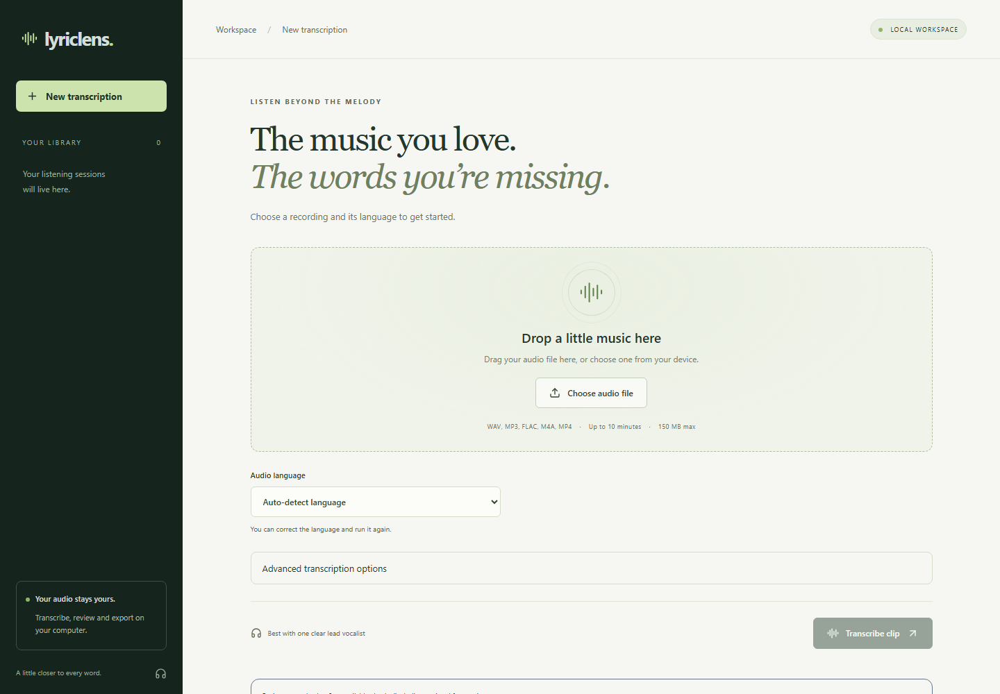

# LyricLens

Review songs with multiple languages using saved per-segment language instructions, and compare differences between the two recognition routes. See the [multilingual review guide](lyriclens-app/docs/MULTILINGUAL.md).

For reference review and reproducible model comparisons, see the [human-reviewed benchmark workflow](lyriclens-app/docs/BENCHMARK.md).

Experimental model adaptation is available through a separate [reviewed-data fine-tuning workflow](lyriclens-app/docs/FINETUNING.md). It does not replace the current models automatically.

Training sources follow a [documented permissions policy](lyriclens-app/docs/TRAINING_SOURCES.md); application code, third-party data and trained weights retain separate licensing requirements.

Turn music into editable transcripts, locally. Upload a recording, compare recognition with and without vocal separation, review timestamps, and export the result.



## Features

- **Seven language choices:** Korean, Japanese, Mandarin Chinese, English, Spanish, Portuguese and French, plus automatic whole-clip detection.
- **Local recognition:** Whisper Small or experimental Large-v3, with optional Demucs vocal separation and side-by-side results.
- **Review and export:** waveform seeking, undo/redo, keyboard shortcuts, segment repeat, playback speed, Unicode editing, passage retranscription, and TXT, JSON or SRT export.
- **Optional local translation:** choose a target language, review translated segments beside the saved source, and export the translation separately.
- **Persistent history:** saved jobs, cancellation and deletion. Audio stays local; the app does not look up songs or retrieve lyrics.
- **Workspace tools:** resume unfinished tasks, inspect stage progress, check local setup and clear generated cache selectively. See [recovery and review tools](lyriclens-app/docs/RELIABILITY.md).
- **Editing and backup:** recover browser drafts, search lyrics, split/merge segments, export bilingual TXT/SRT and restore per-job backups. See the [editing guide](lyriclens-app/docs/EDITING.md).

**Formats:** WAV, MP3, FLAC, M4A and MP4. Default limits: **10 minutes of audio** and **150 MiB per upload**. MP4 processing uses the first audio track and ignores video frames.

## Quick start

Install **Python 3.11**, **Node.js** and **FFmpeg**. From the repository root, in PowerShell:

```powershell
cd lyriclens-app
py -3.11 -m venv .venv
.\.venv\Scripts\python.exe -m pip install -e './backend[inference,tools]'
.\.venv\Scripts\python.exe -m lyriclens.models download
.\.venv\Scripts\python.exe -m uvicorn lyriclens.api:app --host 127.0.0.1 --port 8011
```

In another terminal, starting at the repository root:

```powershell
cd lyriclens-app/frontend
npm.cmd ci
npm.cmd run dev
```

Open **http://127.0.0.1:5181**. Model preparation requires an explicit download; transcription runs locally afterward. This setup enables Small with direct recognition. For Large-v3, vocal separation, GPU setup, Docker or Bash commands, see the [setup guide](lyriclens-app/docs/SETUP.md).

After installing dependencies, start both services on Windows with one command from the repository root:

```powershell
.\start.cmd
```

The launcher reuses healthy services, checks the API connection and writes logs to `.runtime`. Use `.\start.cmd -Gpu` to request CUDA/float16 when starting a new backend with the documented GPU dependencies prepared. No packages or models are downloaded automatically.

## Common problems

| Symptom | Likely cause and solution |
|---|---|
| Browser shows `ERR_CONNECTION_REFUSED` at port 5181 | The frontend may not be running. After initial setup, run `.\start.cmd` from the repository root to start both services. If startup fails, inspect the log named by the launcher under `.runtime`. |
| Server starts, but processing is disabled | A model or FFmpeg may be missing. Check `/api/models` and follow the [model preparation instructions](lyriclens-app/docs/SETUP.md#models-and-explicit-preparation). Downloads must be run explicitly. |
| FFmpeg is unavailable | Run `ffmpeg -version` in the same terminal. Reopen the terminal after installation, or set `LYRICLENS_FFMPEG` to the executable's absolute path. |
| PowerShell blocks `npm.ps1` | Use `npm.cmd ci` and `npm.cmd run dev`, as shown above. No execution-policy change is needed. |
| Inference or vocal separation dependencies fail to install on Python 3.14 | Use the Python 3.11 environment from Quick start. Native inference on Python 3.14 is not verified. |
| GPU processing fails with a CUDA/cuDNN error or missing `cublas64_12.dll` | Follow the [Windows GPU setup](lyriclens-app/docs/SETUP.md#models-and-explicit-preparation), install the `cuda-windows` extra and restart the backend. Alternatively, explicitly select CPU/int8. |
| Transcript is empty, inaccurate or in the wrong language | Select the language manually, compare original audio with vocal separation if prepared, and review/edit the result. Singing and instrumental passages can still produce incorrect words. |
| Export does not include recent edits | Click **Save edits** before exporting. Original TXT exports intentionally use the original recognition result. |

For additional symptoms, including failed model downloads, interrupted jobs and separation errors, see the [troubleshooting guide](lyriclens-app/docs/TROUBLESHOOTING.md).

## Limitations

Singing, accompaniment and overlapping voices can produce incorrect words or hallucinations; timestamps are approximate. Review every transcript. Existing singing results come from small development samples, and Japanese accuracy remains unscored. See the [singing results](lyriclens-app/docs/SINGING.md).

## Documentation

| Guide | Contents |
|---|---|
| [Setup and operations](lyriclens-app/docs/SETUP.md) | Installation, model preparation, GPU, Docker and test commands |
| [Translation](lyriclens-app/docs/TRANSLATION.md) | Optional local model, translated edits and separate exports |
| [Architecture](lyriclens-app/docs/ARCHITECTURE.md) | Backend, frontend, job processing and API |
| [Models](lyriclens-app/docs/MODELS.md) | Profiles, dependencies and third-party attribution |
| [Evaluation](lyriclens-app/docs/EVALUATION.md) | Metrics, references and evaluation protocol |
| [Verification](lyriclens-app/docs/VERIFICATION.md) | Executed checks and remaining limitations |
| [Troubleshooting](lyriclens-app/docs/TROUBLESHOOTING.md) | Common setup and runtime problems |

## License

[MIT](lyriclens-app/LICENSE) for project source. Models, dependencies and datasets have separate licenses documented with their sources. Model weights and downloaded research audio are not included.
